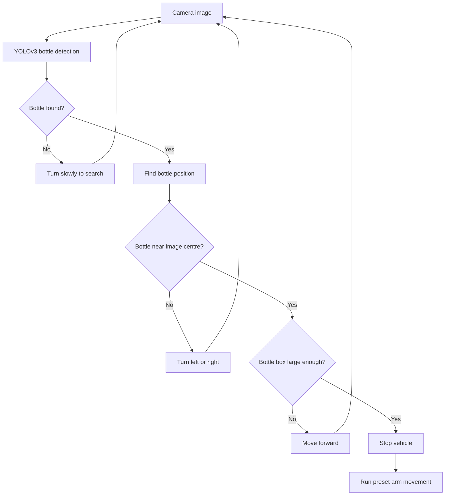

# System operation

The final version of the project is intended to work as follows: the camera sends images to YOLOv3, the vehicle moves according to the position of the detected bottle, and the arm uses preset servo angles after the vehicle stops.

The box size is only an estimate of how close the bottle is; this version does not include obstacle detection or mapping. Test the complete sequence on the actual robot and calibrate it before operation.
